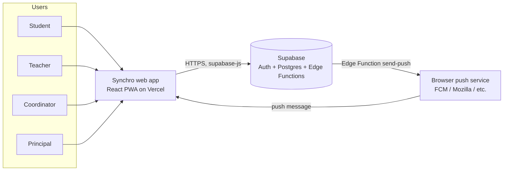
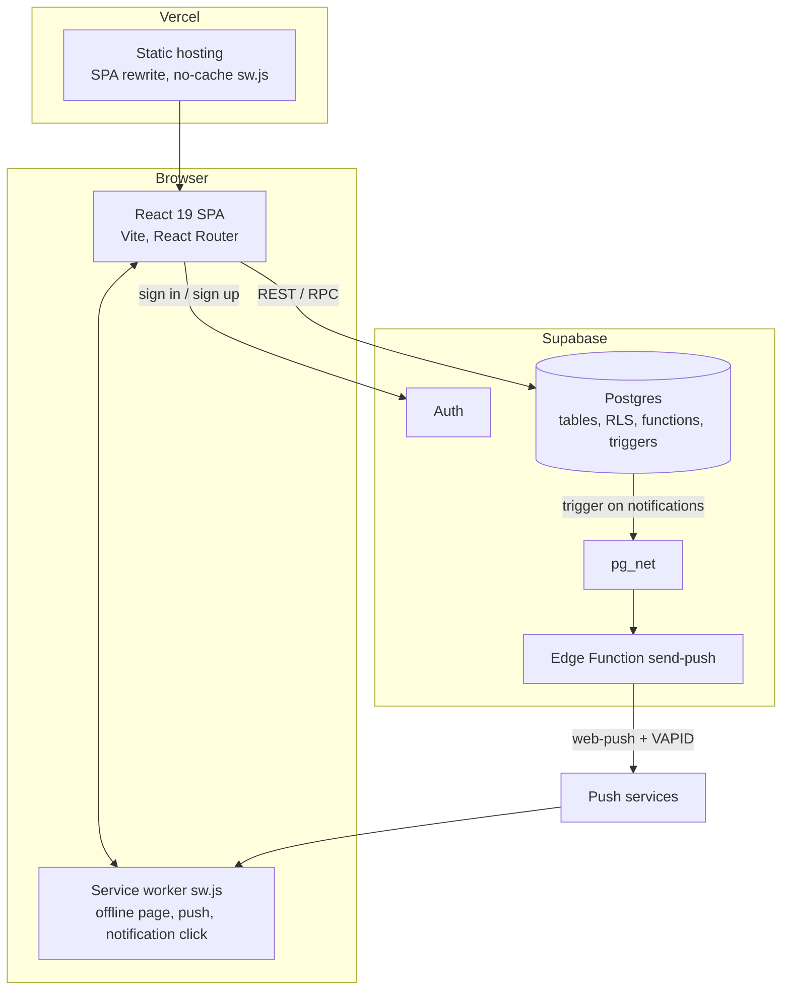
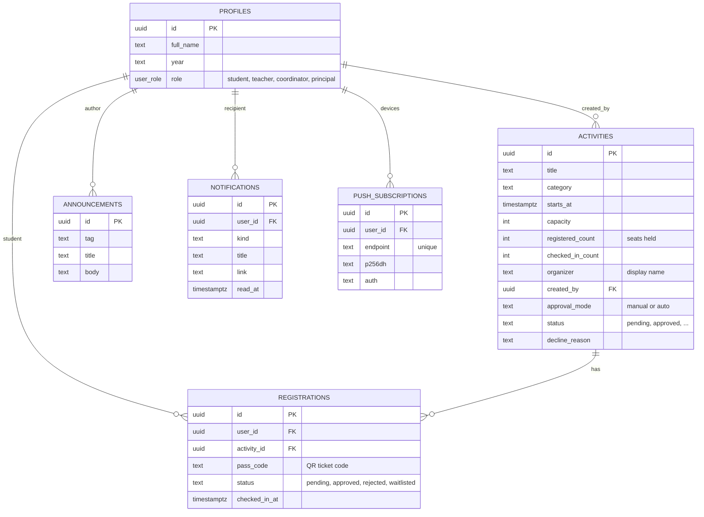
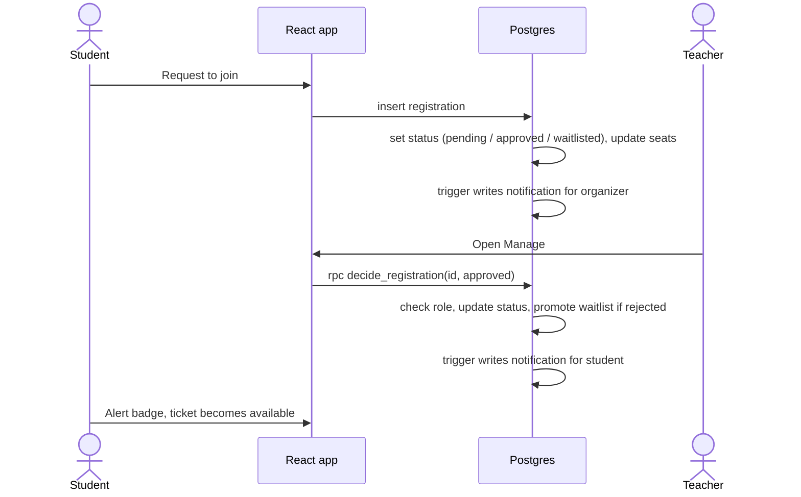
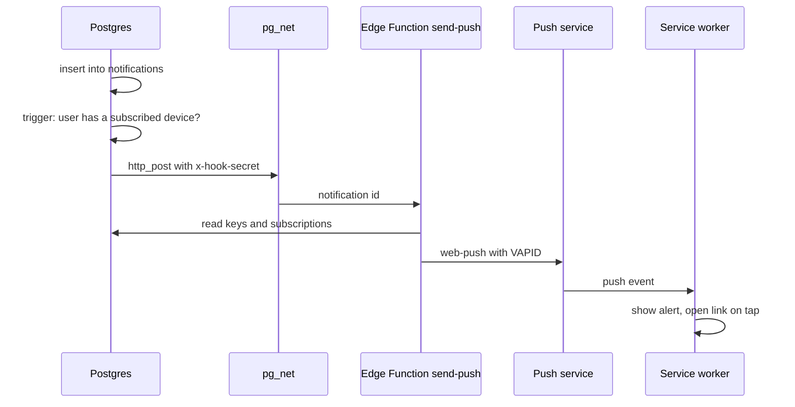

# Synchro: Architecture Design

Synchro is a campus activity app. Students find and join activities, teachers and coordinators run them, and the principal oversees everything. This document describes how it is built and why.

## 1. Goals and constraints

| Goal | How the design meets it |
|---|---|
| One list of who is attending what | Registrations live in one Postgres table with an explicit status |
| Organizers control who gets in | Per-event approval mode, capacity, and an automatic waitlist |
| Rules that cannot be bypassed from the browser | Rules are enforced in the database (RLS and functions), not in React |
| Works on a phone | Installable PWA with an app-style layout at 640px and below |
| No paid services | Supabase and Vercel free tiers, self-generated VAPID keys for web push |

Constraints: no paid API keys; Android and desktop first (iPhone push is out of scope for now); all campus times are stored as UTC and shown as UTC.

## 2. System context



## 3. Containers



| Container | Technology | Responsibility |
|---|---|---|
| Web app | React 19, TypeScript, Vite, React Router | All screens, role-aware navigation, calls Supabase directly |
| Service worker | Plain JS (`public/sw.js`) | Offline fallback page, shows push alerts, opens the right page on tap |
| Hosting | Vercel | Serves the static build, rewrites all paths to `index.html`, never caches `sw.js` |
| Auth | Supabase Auth | Email and password sign-in, issues the JWT that RLS reads |
| Database | Supabase Postgres | Data, access rules, business rules, notification triggers |
| Push sender | Supabase Edge Function `send-push` | Sends Web Push messages with VAPID keys |

There is no custom backend server. The browser talks to Supabase with the public (publishable) key, and the database decides what each user may do.

## 4. Front end

### 4.1 Structure

```
src/
  main.tsx            entry; registers /sw.js in production only
  App.tsx             route table
  store.tsx           session, profile, registrations, theme, institute name
  api.ts              every Supabase call (typed)
  lib/                supabase client, push helpers, useAsync hook
  components/         Layout (sidebar, topbar, tab bar, More sheet), Async, InstallButton
  pages/              one file per screen
```

State is deliberately small: a single React context (`store.tsx`) holds the session, the signed-in profile, the user's registrations, the theme and the institute name. Everything else is fetched per page with the `useAsync` hook. All data access goes through `api.ts`, so screens never build queries.

### 4.2 Routes and who can see them

| Route | Screen | Students | Teachers | Coordinators | Principal |
|---|---|:-:|:-:|:-:|:-:|
| `/login` | Sign in or sign up | public | public | public | public |
| `/`, `/discover`, `/activity/:slug` | Browse and register | yes | yes | yes | yes |
| `/my-activities`, `/calendar`, `/portfolio` | Own registrations, calendar, attendance record | yes | yes | yes | yes |
| `/announcements`, `/notifications` | Feed and inbox (push toggle) | yes | yes | yes | yes |
| `/manage` | Own events, approval queue, registrants | no | yes | yes | yes |
| `/studio` | Plan and create an event | no | yes | yes | yes |
| `/scanner` | QR check-in | no | yes | yes | yes |
| `/principal` | Live analytics, CSV export, event approval | no | no | no | yes |
| `/users` | People and roles, institute name | no | no | no | yes |

Route guards in React only hide screens. They are a convenience, not security (see section 6).

### 4.3 Responsive design

One codebase, two shells. Above 640px: sidebar and topbar with search. At 640px and below: compact app bar, bottom tab bar (Home, Discover, Mine, Alerts with unread badge, More), a More sheet for the rest, and the register button pinned above the tabs. The switch is CSS only; the same components render in both.

## 5. Data model



Also: `app_settings (key, value)` holds the institute name (publicly readable, written only through a principal-only function), and `private.push_config` holds the VAPID keys and the hook secret (unreachable from the browser).

Key rules in the model:

- **Seats held = pending + approved.** `activities.registered_count` counts both, so a request in the queue already holds a seat.
- **Waitlist.** When an event is full, a new request becomes `waitlisted`. Rejecting or cancelling a held seat promotes the next waitlisted student.
- **Approval mode.** `manual` puts a request in `pending` for a teacher or the principal; `auto` approves it immediately if a seat is free.
- **Check-in** is only allowed for `approved` registrations.

## 6. Security model

The browser is untrusted. Security is layered in the database.

1. **Row-level security (RLS)** on every table. Students read and change only their own rows; organizers see registrants of events they manage; the principal sees all.
2. **Column-level grants and triggers.** For example, a user cannot edit their own `role`, and push subscriptions only accept the endpoint and key columns.
3. **`SECURITY DEFINER` functions for privileged actions.** Each one checks the caller's role inside the function before doing anything.

| Function | Purpose | Allowed |
|---|---|---|
| `check_in` | Mark an approved registrant as attended, using the ticket code | teacher, coordinator, principal |
| `event_registrations` | List registrants of one event | event manager |
| `pending_registrations` | Approval queue | event manager |
| `decide_registration` | Approve or reject, promote waitlist | event manager (not for own registration) |
| `analytics_summary` | Dashboard numbers and series | principal |
| `list_users`, `set_user_role` | People and roles (cannot change own role) | principal |
| `set_institute_name` | Rename the institute (2 to 60 characters) | principal |
| `push_config` | Hand VAPID keys to the Edge Function | service role only |

4. **Secrets.** The browser holds only the Supabase URL, the publishable key and the VAPID public key. The VAPID private key and the hook secret live in `private.push_config`, which no browser role can read. The Edge Function accepts calls only with the correct `x-hook-secret` header.

Accepted risks, noted by the Supabase advisor: privileged functions are callable by any signed-in user (they check the role themselves), and leaked-password protection is off.

## 7. Key flows

### 7.1 Request to join and approval



### 7.2 Web push



Devices that return 404 or 410 are deleted from `push_subscriptions`. A user can enable alerts on several devices.

### 7.3 QR check-in

An approved registration shows a QR ticket carrying a `pass_code`. The scanner screen reads it with the camera (or accepts the code typed in) and calls `check_in(code, event)`. The function returns a result instead of failing: `not_found`, `wrong_event`, `not_approved`, `already` or `ok`, and on success it bumps `checked_in_count`.

## 8. Notifications

`notifications` is the single source. Database triggers write rows when a registration is created or changes status, when an event is published, and when an announcement is posted. The app polls the unread count every 30 seconds and on each page change. A second trigger turns a new row into a push if the user has a device. In-app and push alerts therefore always agree.

## 9. Deployment and operations

| Concern | Choice |
|---|---|
| Source | GitHub, private repository `akshithraob/synchro`; feature branches such as `phase-7-reminders` |
| Hosting | Vercel production at `synchro-synchroteam.vercel.app` |
| Config | `VITE_SUPABASE_URL`, `VITE_SUPABASE_PUBLISHABLE_KEY`, optional `VITE_VAPID_PUBLIC_KEY` (`.env.local`, not committed) |
| Schema changes | Versioned SQL migrations applied to the Supabase project |
| Service worker | Registered in production only; cache name is versioned (`synchro-v2`); never caches Supabase or cross-origin requests |
| Build check | `tsc -b` then `vite build` |

Migrations so far: `announcements_principal_write`, `event_management`, `analytics_summary`, `role_management`, `registration_approval`, `notifications`, `web_push`, `institute_name_setting`.

## 10. Design decisions and trade-offs

| Decision | Why | Cost |
|---|---|---|
| No custom server; the database enforces rules | Fewer moving parts, free tier, rules apply to any client | Business logic is SQL, which needs migrations and SQL tests |
| `SECURITY DEFINER` RPCs instead of direct updates | Privileged changes go through one checked door | Each function must repeat the role check |
| Seats held includes pending | Prevents overbooking while requests wait | A pending request can block a seat until decided |
| Own VAPID keys, Edge Function sender | No paid push service | Keys must be managed; private key sits in the database |
| Polling for unread count | Simple, no realtime channel to maintain | Up to 30 seconds of delay in the badge |
| CSS-only phone layout | One component tree to maintain | Some desktop-only elements are hidden, not removed |
| Times stored and shown as UTC | Avoids time-zone bugs across devices | Campus-local times are not converted |

## 11. Quality status

Verified:
- Type-check and production build pass after every change.
- Access rules, the registration flow, waitlist promotion, notifications, analytics and the institute-name rule were tested with rolled-back SQL.
- The send-push function rejects a wrong secret; the key function is not callable by anonymous users.
- The login page renders at a 375px phone width.

Not yet verified:
- Signed-in flows in a browser, and the signed-in phone layout.
- Camera QR scanning.
- PWA install and the offline page.
- Real push delivery on a device.
- Supabase email-confirmation redirect (the Site URL must be set to the Vercel address).

## 12. Roadmap

1. **Deadline reminders:** a registration deadline on events plus a scheduled job (`pg_cron` is available but not installed) that writes reminder notifications.
2. **Results and volunteer hours:** record outcomes per event and total hours per student in the portfolio.
3. iPhone push support, and a clean custom domain.
4. Hardening: turn on leaked-password protection, remove the unused `copilot-plan` function, automated tests for the SQL rules.
